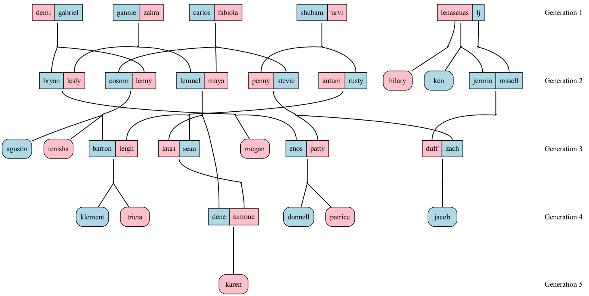

# family_tree_prolog

Simple family tree program in Prolog that represents relationships between family members.
It answers relationship queries (siblings, cousins, ancestors, ...) and draws the family as a
chart with one row per generation.



## Requirements

- [SWI-Prolog](https://www.swi-prolog.org/) (`swipl`)
- [Graphviz](https://graphviz.org/) (`dot`), only needed to draw the image

On macOS: `brew install swi-prolog graphviz`

## How to run

From the project folder:

```sh
# Open the interactive Prolog prompt (type your own queries)
swipl family_tree.pl

# Print every relationship report (parents, siblings, cousins, ...)
swipl family_tree.pl show_all

# List all married couples
swipl family_tree.pl couples

# Draw the family tree image (family_tree.png)
swipl family_tree.pl tree > family.dot && dot -Tpng family.dot -o family_tree.png

# Draw the plain parent -> child graph
swipl family_tree.pl dot > tree.dot && dot -Tpng tree.dot -o tree.png
```

### Ask your own questions

```sh
swipl family_tree.pl
```

Then, at the `?-` prompt:

```prolog
?- spouse(carlos, X).
?- cousin(A, B).
?- generation(karen, G).
```

```prolog
?- show_all.                % same as `swipl family_tree.pl show_all`
```

Press `;` for more answers and `Ctrl-D` to quit.

## Adding people

Edit `family_tree.pl`:

- Add `male(name).` or `female(name).` for each person.
- Add `parent(parent, child).` for each parent/child link.
- Add `married(a, b).` for a couple without children (couples with shared children are detected automatically).

Then regenerate the image with the `tree` command above.

## Available relations

`parent`, `child`, `father`, `mother`, `sibling`, `brother`, `sister`, `grandparent`,
`greatgrandparent`, `grandchild`, `ancestor`, `descendant`, `uncle`, `aunt`, `niece`, `nephew`,
`cousin`, `secondcousin`, `cousin_removed`, `spouse`, `husband`, `wife`, `generation`.
